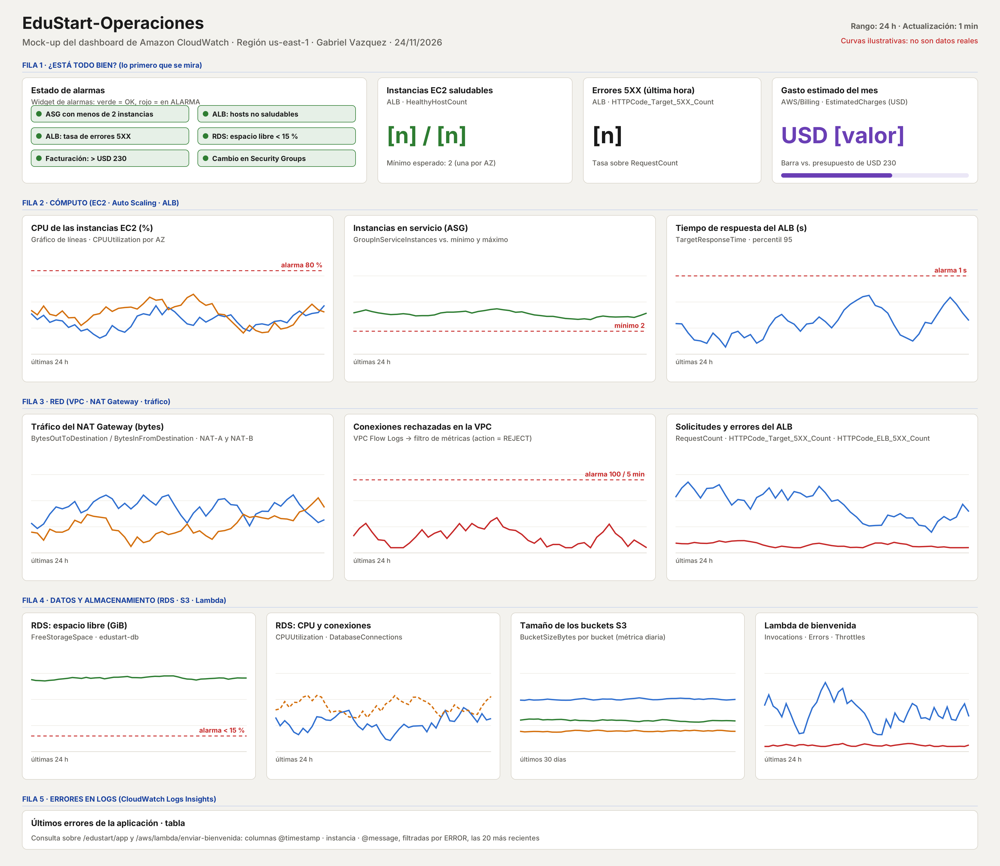

# Pre-entrega 7: Dashboard de monitoreo y plan de alertas CloudWatch

**Proyecto:** EduStart · **Curso:** Cloud Computing (AWS) · Coderhouse
**Alumno:** Gabriel Vazquez · **Fecha:** 24 de noviembre de 2026

Plan de monitoreo para **EduStart**, la plataforma web de la startup de educación diseñada en las pre-entregas anteriores: VPC con dos Zonas de Disponibilidad, ALB, Auto Scaling Group de EC2, NAT Gateways, RDS MySQL Multi-AZ, buckets S3 y una Lambda que envía el correo de bienvenida.

## Contenido del repositorio

| Archivo | Descripción |
|---|---|
| `README.md` | Este documento: recursos, métricas, matriz de alarmas, dashboard y auditoría. |
| `dashboard/mockup-dashboard.png` | Mock-up visual del dashboard. |
| `dashboard/dashboard-edustart.json` | Definición del dashboard en el formato de CloudWatch, lista para importar. |
| `alarmas/matriz-alarmas.csv` | Matriz de alarmas en formato tabla (se abre en Excel o Google Sheets). |
| `auditoria/reglas-aws-config.json` | Reglas administradas de AWS Config a activar. |
| `auditoria/eventbridge-cambios-red.json` | Patrón de EventBridge que alerta sobre cambios en la red registrados por CloudTrail. |
| `auditoria/eventbridge-proteccion-cloudtrail.json` | Patrón que alerta si alguien intenta apagar o modificar CloudTrail. |

> En los JSON, el ID de cuenta `123456789012`, los IDs de NAT Gateway (`nat-0aaa…`) y los sufijos del ALB son valores de ejemplo y se reemplazan por los reales.

## 1. Recursos a monitorear y métricas críticas

Se retoman los recursos de las Pre-entregas 3 a 6. Cada uno es un posible punto de fallo:

| Servicio | Por qué es crítico | Métricas elegidas (CloudWatch) |
|---|---|---|
| **EC2 + Auto Scaling** | Sirven la aplicación; si caen, nadie puede estudiar. | `CPUUtilization`, `StatusCheckFailed`, `GroupInServiceInstances` |
| **Application Load Balancer** | Única puerta de entrada; refleja lo que vive el usuario. | `UnHealthyHostCount`, `HTTPCode_Target_5XX_Count`, `TargetResponseTime`, `RequestCount` |
| **Red (NAT Gateway y VPC)** | Sin NAT, las EC2 no pueden actualizarse; el tráfico rechazado puede indicar un ataque. | `BytesOutToDestination`, `BytesInFromDestination`, `ErrorPortAllocation`, conexiones rechazadas de VPC Flow Logs |
| **RDS MySQL** | Guarda usuarios, inscripciones y notas. | `FreeStorageSpace`, `CPUUtilization`, `FreeableMemory`, `DatabaseConnections` |
| **S3** | Archivos de cursos, estáticos y logs. | `BucketSizeBytes`, `NumberOfObjects` (métricas diarias) |
| **Lambda** | Envía el correo de bienvenida. | `Errors`, `Invocations`, `Throttles` |
| **Facturación** | Evita sorpresas a fin de mes. | `EstimatedCharges` |

Notas técnicas:

- **NAT Gateway:** el curso menciona `NetworkIn` y `NetworkOut`, que son métricas de las instancias EC2. El NAT Gateway publica las suyas en `AWS/NATGateway` con otros nombres: `BytesOutToDestination` y `BytesInFromDestination` equivalen al tráfico de salida y entrada.
- **Errores en logs:** el agente de CloudWatch envía los logs de la aplicación al grupo `/edustart/app`. Un *filtro de métricas* cuenta las líneas con `ERROR`, y los VPC Flow Logs tienen otro filtro para las conexiones rechazadas (`action = REJECT`), que se publica como la métrica personalizada `EduStart/Red · ConexionesRechazadas`.
- **Memoria y disco de las EC2:** CloudWatch no los mide por defecto; los publica el mismo agente.
- **Facturación:** `EstimatedCharges` solo existe en `us-east-1` y requiere activar *Receive Billing Alerts* en la consola de Billing.

## 2. Matriz de alarmas

Todas las alarmas notifican por **Amazon SNS** a dos temas, según la severidad:

- `edustart-alertas-criticas`: el servicio está caído o en riesgo inmediato. Además de la alarma, envía un aviso cuando vuelve a estado OK.
- `edustart-alertas-aviso`: degradación o tendencia preocupante, para revisar en horario laboral.

Ambos temas tienen una suscripción de email a `admin@example.com`, que hay que confirmar desde el correo.

| Servicio | Métrica | Condición (umbral) | Periodo y evaluación | Severidad | Acción de alerta |
|---|---|---|---|---|---|
| Auto Scaling | `GroupInServiceInstances` | < 2 instancias | 5 min · 2 de 2 | Crítica | Correo a admin@example.com (SNS críticas) |
| EC2 | `StatusCheckFailed` | ≥ 1 | 5 min · 2 de 2 | Crítica | Correo a admin@example.com (SNS críticas) |
| EC2 | `CPUUtilization` (promedio del ASG) | > 80 % | 5 min · 3 de 3 | Aviso | Correo a admin@example.com (SNS aviso) |
| ALB | `UnHealthyHostCount` | ≥ 1 | 5 min · 1 de 1 | Crítica | Correo a admin@example.com (SNS críticas) |
| ALB | Tasa de 5XX (`HTTPCode_Target_5XX_Count` / `RequestCount` × 100) | > 2 % | 5 min · 2 de 2 | Crítica | Correo a admin@example.com (SNS críticas) |
| ALB | `TargetResponseTime` (p95) | > 1 s | 5 min · 3 de 3 | Aviso | Correo a admin@example.com (SNS aviso) |
| NAT Gateway | `ErrorPortAllocation` | > 0 | 5 min · 1 de 1 | Aviso | Correo a admin@example.com (SNS aviso) |
| NAT Gateway | `BytesOutToDestination` | Fuera de la banda de detección de anomalías | 5 min · 3 de 3 | Aviso | Correo a admin@example.com (SNS aviso) |
| VPC | Conexiones rechazadas (Flow Logs) | > 100 | 5 min · 1 de 1 | Aviso | Correo a admin@example.com (SNS aviso) |
| RDS | `FreeStorageSpace` | < 3 GiB (15 % de 20 GiB) | 5 min · 1 de 1 | Crítica | Correo a admin@example.com (SNS críticas) |
| RDS | `CPUUtilization` | > 80 % | 5 min · 3 de 3 | Aviso | Correo a admin@example.com (SNS aviso) |
| RDS | `FreeableMemory` | < 100 MB | 5 min · 3 de 3 | Aviso | Correo a admin@example.com (SNS aviso) |
| Lambda | `Errors` (enviar-bienvenida) | > 0 | 5 min · 1 de 1 | Aviso | Correo a admin@example.com (SNS aviso) |
| Facturación | `EstimatedCharges` | > USD 210 (se superó el gasto estimado del mes) | 6 h · 1 de 1 | Aviso | Correo a admin@example.com (SNS aviso) |
| Facturación | `EstimatedCharges` | > USD 230 (se superó el presupuesto) | 6 h · 1 de 1 | Crítica | Correo a admin@example.com (SNS críticas) |
| Facturación (AWS Budgets) | Gasto **proyectado** a fin de mes | > USD 230 | Revisión diaria de Budgets | Aviso | Correo a admin@example.com |
| CloudTrail | `CambiosRed` (filtro sobre los logs del trail: cambios en SG, NACL, rutas, gateways) | ≥ 1 | 5 min · 1 de 1 | Crítica | Correo a admin@example.com (SNS críticas) |

### Cómo se evitan las alarmas "ruidosas"

- **Ningún periodo es menor a 5 minutos**, y las métricas que pueden tener picos normales (CPU, latencia) exigen **3 periodos seguidos**, o sea 15 minutos sostenidos. Un pico de 2 minutos al abrir una clase no despierta a nadie.
- **El umbral de CPU (80 %) está por encima de la política de escalado (60 %).** Primero actúa el Auto Scaling solo; la alarma suena únicamente si el escalado no alcanza.
- **Los errores 5XX se miden como tasa, no como cantidad.** Con mucho tráfico, 10 errores pueden ser normales; un 2 % de las solicitudes fallando no lo es.
- **El tráfico del NAT usa detección de anomalías:** CloudWatch aprende el patrón habitual (por ejemplo, más tráfico de día que de noche) y avisa solo si se sale de lo esperado, en lugar de fijar un número arbitrario.
- **Dos niveles de severidad:** lo crítico llega a un tema separado, así no se mezcla con los avisos.

### Alarma de costos (`EstimatedCharges`)

La métrica es obligatoria en cualquier proyecto cloud y acumula el gasto del mes en curso, que vuelve a cero el día 1. Para fijar umbrales realistas, primero se estimó el costo mensual de la arquitectura completa, con precios de lista on-demand de us-east-1 y 730 horas por mes:

| Componente | Supuesto | USD / mes |
|---|---|---:|
| EC2 | 2 × t3.micro encendidas todo el mes (0,0104 USD/h) | 15,18 |
| EBS y snapshots | 2 volúmenes gp3 de 20 GiB (0,08 USD/GiB) + snapshots incrementales y AMIs | 5,20 |
| Application Load Balancer | 0,0225 USD/h + ~1 LCU promedio (0,008 USD/LCU-h) | 22,27 |
| NAT Gateways | 2 × 0,045 USD/h + ~50 GB procesados (0,045 USD/GB) | 67,95 |
| IPv4 públicas | 4 direcciones (2 del ALB + 2 IP elásticas de los NAT) × 0,005 USD/h | 14,60 |
| RDS MySQL Multi-AZ | db.t3.micro Multi-AZ (0,034 USD/h) + 20 GiB gp3 Multi-AZ (0,23 USD/GiB) | 29,42 |
| VPC interface endpoints | Secrets Manager y SNS en 2 AZ (4 × 0,01 USD/h) | 29,20 |
| Secrets Manager | 1 secreto | 0,40 |
| S3 | ~50 GB entre los tres buckets + solicitudes | 2,00 |
| CloudWatch | Alarmas (las 10 primeras son gratis), ~10 GB de logs y Flow Logs (0,50 USD/GB) | 8,00 |
| AWS Config y CloudTrail | Ítems de configuración y evaluaciones; el primer trail de eventos de administración es gratis | 4,00 |
| Route 53 | 1 zona alojada (0,50 USD) + consultas | 1,00 |
| CloudFront, Lambda, SNS y SES | Dentro de las capas gratuitas permanentes o pocos centavos | 2,00 |
| **Total estimado** | | **≈ 201** |

**Presupuesto mensual: USD 230.** Es el gasto estimado más un margen de ~15 % para los picos del Auto Scaling (hasta 6 instancias en semanas de exámenes) y más tráfico del previsto. No incluye créditos de capa gratuita, que bajarían el costo en una cuenta nueva.

A partir de ahí, las tres alertas de costos son:

1. **AWS Budgets, gasto proyectado > USD 230 (aviso temprano).** Budgets calcula hacia dónde va el mes y avisa en los primeros días si la tendencia apunta a superar el presupuesto, cuando todavía hay tiempo de corregir.
2. **`EstimatedCharges` > USD 210 (aviso).** El gasto ya superó lo estimado para todo el mes, así que algo consume más de lo previsto.
3. **`EstimatedCharges` > USD 230 (crítica).** Se superó el presupuesto.

**Por qué no se usan porcentajes como 50 % u 80 %:** como el gasto se acumula durante el mes, llegar al 50 % alrededor del día 15 es lo normal. Esas alarmas sonarían todos los meses sin que pase nada, el típico caso de alarma ruidosa. Por la misma razón se descarta el umbral fijo de USD 10 del ejemplo del curso: sirve para una cuenta de práctica, pero acá solo los dos NAT Gateways cuestan unos USD 2 por día, así que se superaría en la primera semana.

**Las dos líneas que más pesan son los NAT Gateways (≈ 34 %) y los VPC endpoints (≈ 15 %).** Si hiciera falta recortar, son lo primero a revisar: usar un solo NAT en desarrollo, o quitar los endpoints y dejar que ese tráfico salga por el NAT.

> Los precios son los de lista de AWS al momento de escribir este plan y pueden cambiar. Conviene validarlos con la [AWS Pricing Calculator](https://calculator.aws/) antes de fijar el presupuesto definitivo.

## 3. Mock-up del dashboard `EduStart-Operaciones`

El panel se lee **de arriba hacia abajo y de lo general a lo particular**: primero si hay un problema, después dónde está.

| Fila | Qué muestra | Widgets |
|---|---|---|
| **1. ¿Está todo bien?** | Lo primero que se mira, de un vistazo | Widget de estado de alarmas (verde/rojo) · número de instancias saludables · errores 5XX de la última hora · **gasto estimado del mes** con barra contra el presupuesto de USD 230 |
| **2. Cómputo** | Salud y carga de los servidores | Gráfico de líneas de CPU de las EC2 en las últimas 24 h con la línea de alarma en 80 % · instancias en servicio del ASG contra el mínimo de 2 · tiempo de respuesta p95 del ALB |
| **3. Red** | Tráfico y posibles ataques | Bytes de entrada y salida de cada NAT Gateway · conexiones rechazadas en la VPC · solicitudes y errores del ALB |
| **4. Datos y almacenamiento** | Base de datos, archivos y Lambda | Espacio libre de RDS con la línea del 15 % · CPU y conexiones de RDS · tamaño de cada bucket S3 en los últimos 30 días · invocaciones y errores de la Lambda |
| **5. Errores en logs** | El detalle para investigar | Tabla de CloudWatch Logs Insights con los 20 errores más recientes de la app y de la Lambda |

El archivo `dashboard/dashboard-edustart.json` contiene esta misma distribución. Se puede importar en **CloudWatch › Dashboards › Create dashboard › Actions › View/edit source**, pegando el JSON después de reemplazar los IDs de ejemplo.

## 4. Plan de auditoría y cumplimiento

### 4.1 AWS CloudTrail: quién cambió qué

| Configuración | Valor |
|---|---|
| Trail | `edustart-trail`, **multi-región**, eventos de administración de lectura y escritura |
| Destino | Bucket privado `edustart-cloudtrail-logs-prod-use1`, siguiendo la convención de nombres de la Pre-entrega 4, con cifrado y Block Public Access |
| Integridad | *Log file validation* activado, para detectar si alguien altera los registros |
| Integración | Reglas de **Amazon EventBridge** para alertas en tiempo real, y envío a CloudWatch Logs, donde un filtro de métricas cuenta los cambios de red y alimenta la alarma `edustart-cambio-red` del dashboard |
| Retención | Ciclo de vida del bucket: Glacier Flexible Retrieval a los 90 días y borrado al año, igual que los logs |

**Rastrear quién modificó un Security Group.** Cada cambio sobre `SG-ALB`, `SG-Web-Servers` o `SG-DB` (Pre-entrega 6) queda registrado como un evento de CloudTrail. Para investigarlo, se entra en **CloudTrail › Event history**, se filtra por *Resource name* con el ID del Security Group o por *Event name* (por ejemplo, `AuthorizeSecurityGroupIngress`), y el evento muestra:

- **Quién:** `userIdentity.arn`, el usuario o rol que hizo el cambio.
- **Desde dónde:** `sourceIPAddress`.
- **Cuándo:** `eventTime`.
- **Qué cambió:** `requestParameters`, por ejemplo el puerto 3306 abierto a `0.0.0.0/0`.

El historial de eventos cubre los últimos 90 días; el trail guarda todo lo anterior en S3.

**Eventos críticos que disparan una alerta inmediata.** La regla de EventBridge (`auditoria/eventbridge-cambios-red.json`) envía al tema de alertas críticas cualquiera de estos eventos:

| Categoría | Eventos de CloudTrail | Por qué es crítico |
|---|---|---|
| Security Groups | `AuthorizeSecurityGroupIngress`, `AuthorizeSecurityGroupEgress`, `RevokeSecurityGroupIngress`, `RevokeSecurityGroupEgress`, `ModifySecurityGroupRules`, `CreateSecurityGroup`, `DeleteSecurityGroup` | Abrir el puerto 3306 de `SG-DB` a Internet expondría la base de datos |
| NACLs | `CreateNetworkAclEntry`, `ReplaceNetworkAclEntry`, `DeleteNetworkAclEntry` | Cambian qué tráfico entra a cada subred |
| Ruteo | `CreateRoute`, `ReplaceRoute`, `DeleteRoute` | Una ruta borrada deja a las subredes privadas sin salida por el NAT |
| Gateways | `AttachInternetGateway`, `DetachInternetGateway`, `DeleteNatGateway` | Pueden cortar el acceso a la plataforma |
| VPC | `DeleteVpc`, `DeleteSubnet` | Destruyen la red |
| CloudTrail | `StopLogging`, `DeleteTrail`, `UpdateTrail` | Alguien intenta borrar sus huellas (`auditoria/eventbridge-proteccion-cloudtrail.json`) |

### 4.2 AWS Config: que la infraestructura siga cumpliendo las reglas

**Configuración base:** el *configuration recorder* registra todos los tipos de recursos de la región y guarda el historial de configuración en S3. Un cambio de cumplimiento (*Config Rules Compliance Change*) se envía por EventBridge al tema `edustart-alertas-aviso`.

**Las tres reglas principales** (reglas administradas por AWS):

| Regla | Identificador | Qué verifica | Relación con el proyecto |
|---|---|---|---|
| `s3-bucket-public-read-prohibited` | `S3_BUCKET_PUBLIC_READ_PROHIBITED` | Ningún bucket S3 permite lectura pública | Los buckets de la Pre-entrega 4 son privados por diseño; si alguien abre uno, Config lo marca como no conforme |
| `restricted-ssh` | `INCOMING_SSH_DISABLED` | Ningún Security Group permite SSH (puerto 22) desde `0.0.0.0/0` | Las EC2 están en subredes privadas y no deben aceptar SSH desde Internet |
| `rds-instance-public-access-check` | `RDS_INSTANCE_PUBLIC_ACCESS_CHECK` | La base de datos no es accesible públicamente | RDS se creó con *Publicly accessible = No* (Pre-entrega 5) |

**Reglas complementarias**, también incluidas en `auditoria/reglas-aws-config.json`:

- `s3-bucket-public-write-prohibited`: ningún bucket permite escritura pública.
- `cloudtrail-enabled`: CloudTrail sigue activo.
- `vpc-flow-logs-enabled`: la VPC sigue enviando sus Flow Logs, que alimentan la métrica de conexiones rechazadas del dashboard.

### 4.3 Cómo se complementan

**CloudTrail** responde *quién hizo el cambio y cuándo*. **AWS Config** responde *si el resultado sigue cumpliendo las reglas*. Por ejemplo, si alguien abre el puerto 22 a Internet en `SG-Web-Servers`:

1. CloudTrail registra `AuthorizeSecurityGroupIngress` y EventBridge envía una alerta crítica en el momento.
2. AWS Config marca el Security Group como no conforme con `restricted-ssh` hasta que se corrija.
3. En el dashboard, la alarma `edustart-cambio-red` (filtro de métricas sobre los logs de CloudTrail) aparece en rojo en el widget de alarmas.
